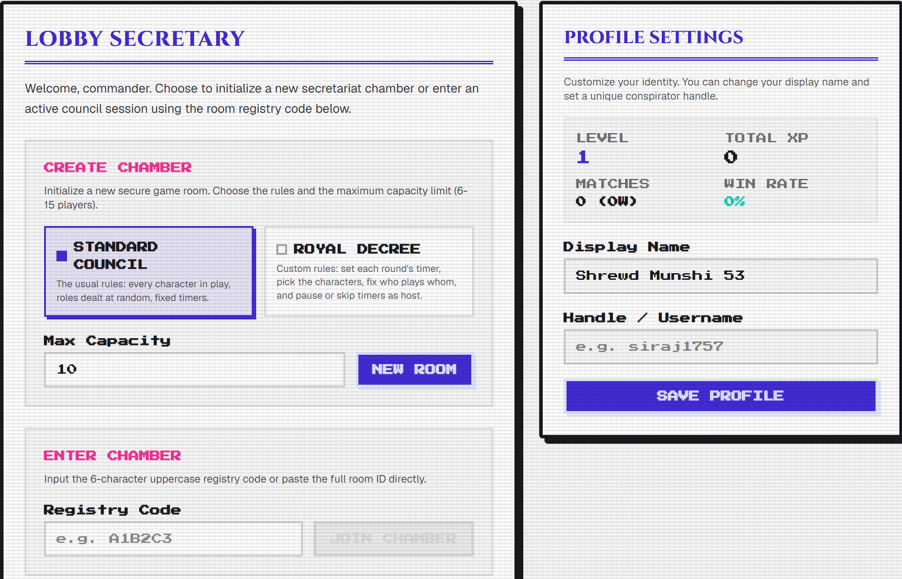
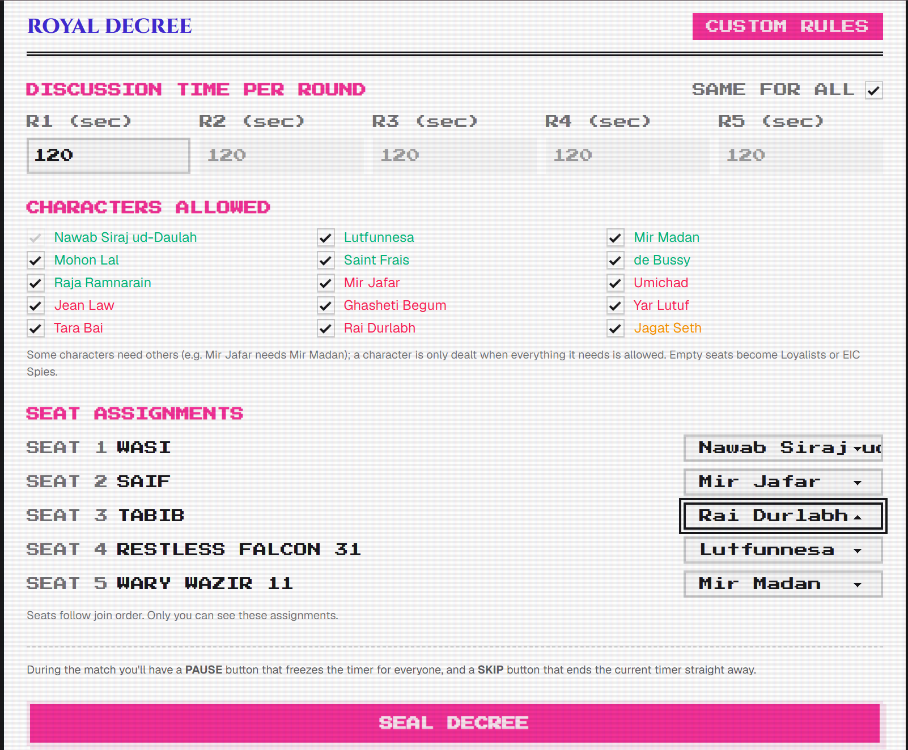
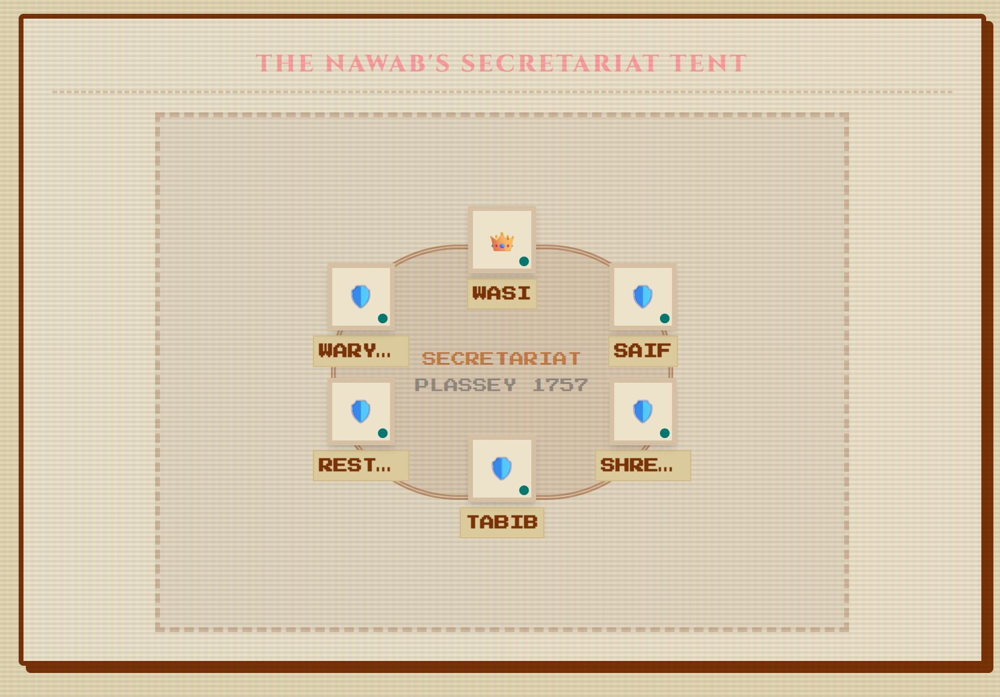
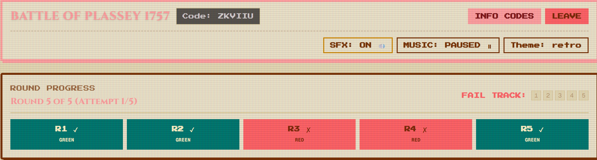
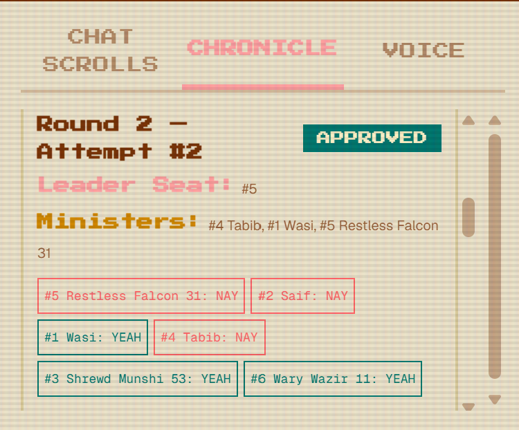
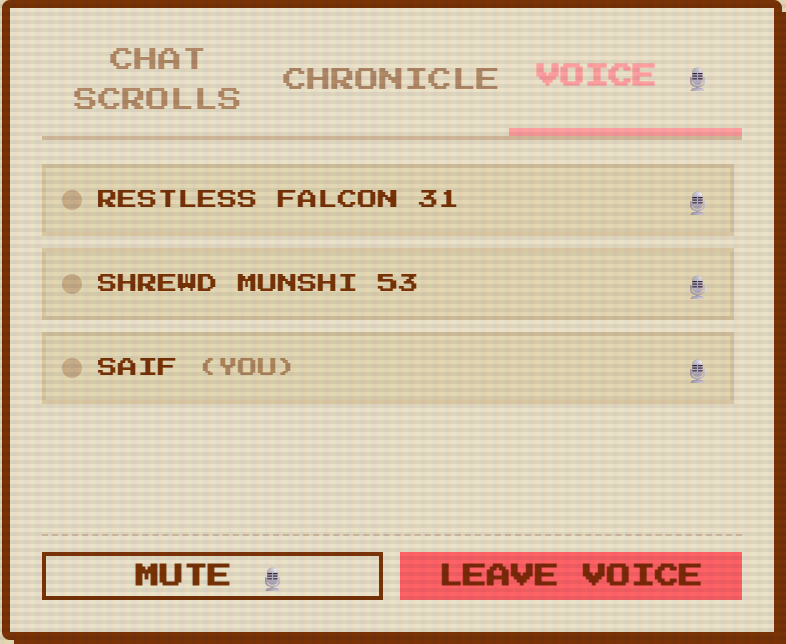
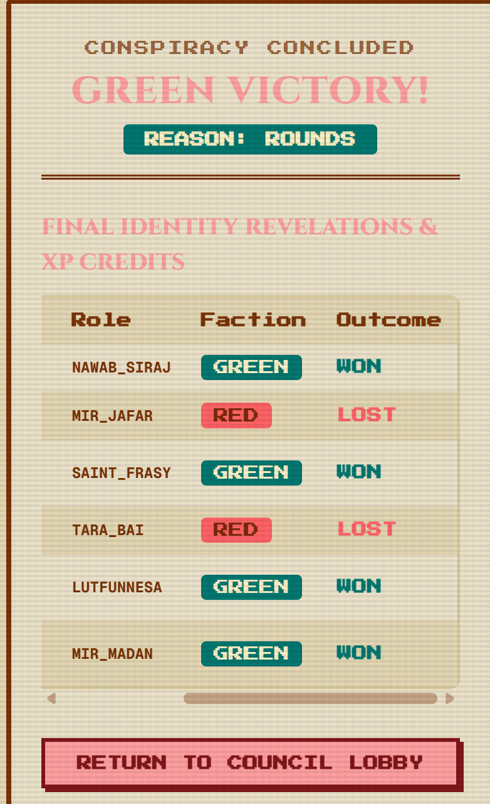

# 1757

**A real-time multiplayer social-deduction game set at the Battle of Plassey.**

[](https://github.com/SaifSarker11/1757-RPG/actions/workflows/ci.yml)

<table>
  <tr>
    <td width="50%"><br><sub><b>Lobby and profile:</b> create or join by code, pick Standard Council or Royal Decree, track level, XP and win rate.</sub></td>
    <td width="50%"><br><sub><b>Royal Decree:</b> per-round discussion timers, allowed characters, host-assigned roles.</sub></td>
  </tr>
  <tr>
    <td><br><sub><b>The Nawab's Secretariat Tent:</b> six players seated, the leader's crown and online dots.</sub></td>
    <td><br><sub><b>Room header and round track:</b> room code, SFX/music/theme, rounds R1–R5 and the fail track.</sub></td>
  </tr>
  <tr>
    <td><br><sub><b>The Chronicle:</b> every ballot, with the leader, chosen ministers and each YEAH/NAY vote.</sub></td>
    <td><br><sub><b>Voice chat:</b> peer-to-peer audio with participants, mute and leave.</sub></td>
  </tr>
  <tr>
    <td><br><sub><b>Post-game:</b> the winning side, the reason, every role revealed and each player's result.</sub></td>
    <td></td>
  </tr>
</table>

---

## What is 1757?

Bengal, June 1757. The Nawab's court is full of traitors, and nobody knows who they are.

- **The Nawab's Loyalists (Green)** form the majority, but they don't know who the traitors are.
- **The East India Company's conspirators (Red)** hide inside the court, mostly know each other, and sabotage missions.
- **Jagat Seth** is the one neutral exception, not a third faction. The banker is only dealt in games of 9 or more players and wins **alone** with a correct guess in the endgame.

Each game has **6–15 players** and **5 rounds**. The first side to win **3 rounds** moves on to the endgame. Every player gets a secret historical role (Nawab Siraj ud-Daulah, Mir Jafar, Lutfunnesa, Jean Law, …), and most roles come with their own power or hidden knowledge.

## How a round works

```
Role reveal → Discussion → Leader picks ministers → Everyone votes → Ministers play cards → Result
```

1. **Role reveal:** you see your role and anything your role lets you know about others.
2. **Discussion:** talk, accuse and bluff. The host sets the timer (30–300 s, default 120 s).
3. **Selection:** the **Leader** picks ministers for the mission. Team size depends on player count and round (e.g. 2-3-4-3-4 at 6 players).
4. **Ballot:** everyone votes Approve or Reject. **A tie means rejected.** Leadership passes to the next seat after every vote. **Five rejections in one round give that round to Red.**
5. **Mission:** each minister secretly plays **Success** or **Sabotage**. One Sabotage fails the round, except Round 4 with 7+ players, which needs two.
6. **Result:** the cards are revealed (shuffled, so nobody can tell who played what) and the round is scored.

**Endgame (after a side wins 3 rounds):**

- **Mir Jafar's steal:** if Green won on rounds, Mir Jafar gets one guess. Naming **Mir Madan** correctly steals the win for Red.
- **Jagat Seth's gamble:** if Jagat Seth is in the game, he then names one player: **Mir Jafar** if Green is winning, **Rai Durlabh** if Red is winning. A correct guess wins the whole game for Jagat Seth alone.

## Features

- **Play as a guest or with an account:** email/password or one-click anonymous guest, via Better Auth.
- **Public and private rooms** with a 6-character join code, quick-join and kick.
- **Royal Decree custom mode:** per-round discussion timers, a choice of which characters are allowed, host-assigned roles, and host pause/skip.
- **Text chat and peer-to-peer voice chat** (WebRTC) inside every room.
- **30-second reconnect grace:** drop out and rejoin without losing your seat.
- **15 named roles plus 2 fillers** (Loyalist and EIC Spy), with role dependencies such as Mir Jafar ⇄ Mir Madan.
- **Progression:** XP, levels, match history and win rate on your profile.
- **Admin telemetry dashboard:** match analytics, player stats and user moderation.

## Tech stack

| Layer | Technology |
|---|---|
| Web & admin clients | Next.js 16, React 19, Tailwind CSS 4, DaisyUI 5 |
| Mobile client | Expo 54 (React Native 0.81) |
| API & real-time | Fastify 5, Socket.IO 4, WebRTC (voice) |
| Game engine | Pure TypeScript, no I/O |
| Auth | Better Auth (email/password, anonymous guests) |
| Data | PostgreSQL (Neon) via Prisma 7, Redis via ioredis |
| Tooling | pnpm 9 workspaces, Turborepo, Vitest, GitHub Actions, Docker |

## Architecture

```mermaid
flowchart LR
  subgraph Clients
    W[Web · Next.js]
    A[Admin · Next.js]
    M[Mobile · Expo]
  end
  W & A & M -- HTTP + Socket.IO --> API[API · Fastify + Socket.IO]
  API --> E[game-engine<br/>reduce&#40;state, action&#41;]
  API <--> R[(Redis<br/>live game snapshots)]
  API <--> P[(PostgreSQL via Prisma<br/>users · rooms · match history)]
```



The game engine (`packages/game-engine`) is a pure function, `reduce(state, action, now, rng) → { state, events }`, with no network, database or clock of its own. That makes every rule deterministic and unit-testable. The API runs the engine, stores the state in Redis so live games survive a restart, and sends **each player their own `game:view`**, filtered so nobody receives secrets their role shouldn't see.

## Repository layout

```
/code/                        all source code (Turborepo + pnpm monorepo)
/doc/                         SRS, design, presentation, final report, screenshots
README.md                     this file
render.yaml                   Render Blueprint for the API
.github/workflows/ci.yml      CI: install, typecheck, test, build
```

```
code/
├── apps/
│   ├── api/              Fastify + Socket.IO server: REST, auth, lobby, real-time game
│   ├── web/              Next.js player client
│   ├── admin/            Next.js admin and telemetry dashboard
│   └── mobile/           Expo React Native client
├── packages/
│   ├── game-engine/      deterministic game rules (FSM, roles, voting, endgame)
│   ├── db/               Prisma schema and generated client
│   ├── auth/             shared Better Auth configuration
│   ├── config/           loads the single code/.env for every app
│   ├── types/            shared TypeScript types
│   ├── ui/               shared React components
│   ├── eslint-config/    shared lint rules
│   └── typescript-config/ shared tsconfig presets
├── docs/                 developer docs (REST API, socket events, deployment)
├── Dockerfile            production image for the API
└── docker-compose.yml    local Postgres, Redis and API containers
```

## Getting started

### Prerequisites

- **Node.js 20** (CI and the Docker image use Node 20; Next.js 16 needs at least 20.9)
- **pnpm 9.0.0:** `corepack enable && corepack prepare pnpm@9.0.0 --activate`
- **Docker** (optional, for a local Redis)
- A free **[Neon](https://neon.tech) Postgres** database. The database client uses Neon's serverless driver, so a plain local Postgres won't work.

### Run it locally

```bash
git clone https://github.com/SaifSarker11/1757-RPG.git
cd 1757-RPG/code

# 1. Install dependencies
pnpm install

# 2. Create your environment file and fill it in
cp .env.example .env
```

Every app reads the one `code/.env` file. The variables are:

| Variable | Needed for |
|---|---|
| `DATABASE_URL` | Neon **pooled** connection (host contains `-pooler`) |
| `DIRECT_URL` | Neon **direct** connection, used by the Prisma CLI |
| `BETTER_AUTH_SECRET` | session signing (`npx @better-auth/cli secret`) |
| `BETTER_AUTH_URL`, `WEB_URL`, `ADMIN_URL`, `API_URL` | app origins (defaults in `.env.example` are correct for local) |
| `NEXT_PUBLIC_API_URL`, `NEXT_PUBLIC_WS_URL`, `EXPO_PUBLIC_API_URL` | where clients find the API |
| `REDIS_URL` | optional: without it, live games are kept in memory |
| `PORT`, `NODE_ENV`, `COOKIE_DOMAIN` | optional runtime settings |

```bash
# 3. (Optional) start Redis in Docker
docker compose up -d redis
#    then set REDIS_URL="redis://localhost:6379" in .env

# 4. Generate the Prisma client and push the schema to your database
pnpm db:generate
pnpm db:push

# 5. Start everything
pnpm dev
```

| App | URL |
|---|---|
| Web (the game) | http://localhost:3000 |
| API | http://localhost:3001 (health: `/health`) |
| Admin | http://localhost:3002 |
| Mobile (Expo / Metro) | http://localhost:8081 |

To run only the game, use `pnpm dev --filter=web --filter=api`. If a port is stuck on Windows, run `pnpm dev:kill`.

## Testing

```bash
cd code
pnpm test                               # every suite, through Turborepo
pnpm --filter @repo/game-engine test    # just the game engine
pnpm typecheck                          # TypeScript across all packages
```

Tests use **Vitest**:

- **`packages/game-engine`** (23 files): role dealing and dependencies, every phase transition, ballot and tie rules, mission scoring, the fail track, timeouts, abilities, endgame guesses and per-player vision.
- **`apps/api`** (19 files): room REST routes, lobby rules, room codes, socket handlers and real-time broadcasting, reconnect grace, match persistence, user stats and admin queries.

Manual test scripts are in [`code/docs/manual-testing.md`](code/docs/manual-testing.md).

## Building and deployment

| Part | Where | How |
|---|---|---|
| API | **Render** | Docker image from `code/Dockerfile`, declared in [`render.yaml`](render.yaml) |
| Web and admin | **Vercel** | Git integration, one project per app (`code/apps/web`, `code/apps/admin`) |
| CI | **GitHub Actions** | [`ci.yml`](.github/workflows/ci.yml): install, Prisma generate, typecheck, test, build; pushes to `main` also trigger the Render deploy |

```bash
cd code
pnpm build                                   # build every app
docker build -t 1757-api -f Dockerfile .     # build the API image
```

See [`code/docs/deployment.md`](code/docs/deployment.md) for environment variables per platform.

## Documents

| Document | File |
|---|---|
| Software Requirements Specification | [`doc/srs.pdf`](doc/srs.pdf) |
| Design document | [`doc/design.pdf`](doc/design.pdf) |
| Final presentation | [`doc/final-presentation.pdf`](doc/final-presentation.pdf) |
| Final report | [`doc/final-report.pdf`](doc/final-report.pdf) |

## Team

| Member | Student ID | Responsibilities |
|---|---|---|
| Wasi Omar Syed | 230042143 | Game engine, FSM, rounds, voting, roles and rooms |
| Md. Saif-Al Sarker | 230042106 | Auth, real-time chat, web UI and tests |
| M Safwan Hasan Khan | 230042117 | Docker, deployment, Redis/Postgres data layer, CI/CD and the admin dashboard |

**Course:** SWE 4404 Software Project Lab II, Islamic University of Technology

**Supervisor:** _TODO: add supervisor name and designation_
