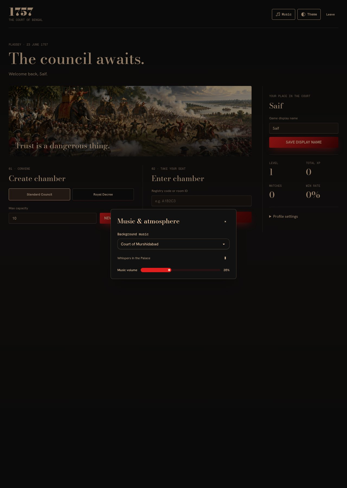
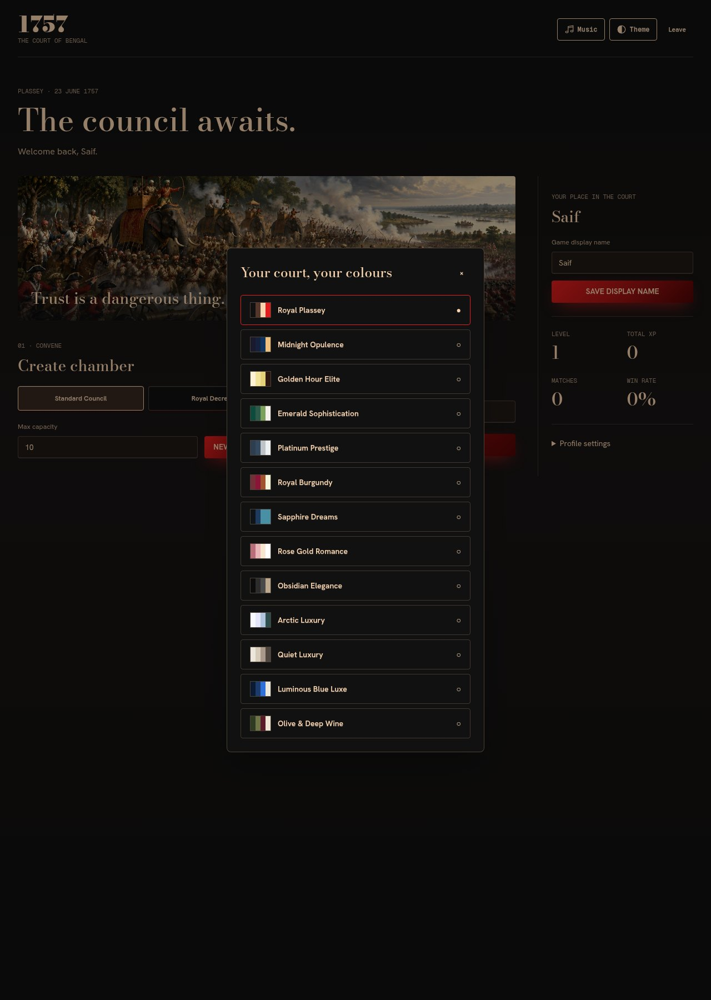
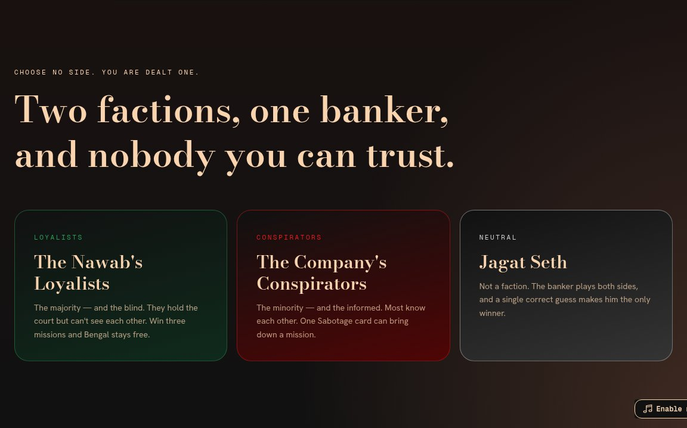
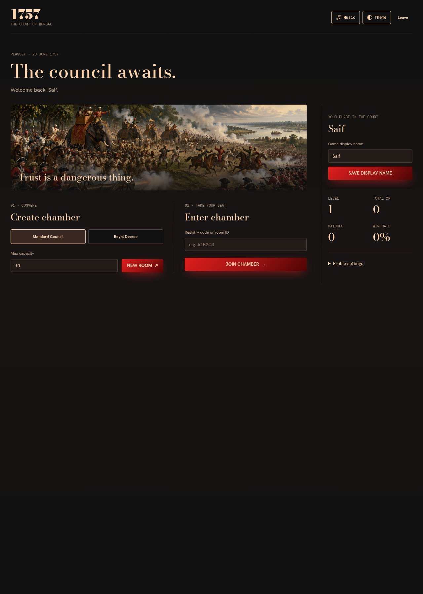

# 1757-RPG

A real-time multiplayer hidden-role deduction game set in 1757 Bengal, built as a monorepo with Turborepo.

## Look and feel

- **Default royal palette (preserved):**
  | Colour | Hex | Used for |
  |---|---|---|
  | Warm Champagne Gold | `#f9d4af` | headings, body text, highlights, active borders |
  | Rich Espresso Bronze | `#55362a` | secondary surfaces, card borders, muted accents |
  | Deep Royal Crimson | `#4f0505` | elevated cards, section gradients, hover states |
  | Obsidian Black | `#111111` | page background, modals |
  | Pure Royal Red | `#e01e1e` | primary buttons, active badges, urgent indicators |
- **Gradients:** surfaces `#111111 → #4f0505`, cards `#4f0505 → #55362a`, primary buttons `#e01e1e → #4f0505` with `#f9d4af` text.
- **Artwork:** a panoramic Plassey battlefield with troops, artillery and elephants beneath the **1757** title. The commanders’ duel appears only in the transition gallery.
- **Transitions:** fifteen distinct historical illustrations, randomly shuffled without repeats until every scene has appeared. Consecutive repeats across cycles are prevented; the cycle survives page reloads within the tab. Images are preloaded, failed images never leave a blank overlay, and reduced-motion preferences are respected.
- **Battle recap:** every match ends with a full-width report covering the winner and reason, round scores, ministers, all ballots and votes, mission cards, Mir Madan's reveal, Jagat Seth's gamble, and every player's final identity and result.

### Personal themes and music

**Royal Plassey** is the default. The **Theme** picker is available beside Music from the first screen; the selected palette continues through login, dashboard and room.

Royal Plassey remains first and unchanged. The alternatives use all twelve combinations currently published in [Brandlic's luxury palette guide](https://brandlic.studio/9-luxury-color-palettes-that-define-high-end-design-in-2025/), including its three 2026–2027 additions.

| Theme | Reference colours |
|---|---|
| Royal Plassey (default) | `#111111` / `#55362a` / `#4f0505` / `#f9d4af` / `#e01e1e` |
| Midnight Opulence | `#1a1a2e` / `#16213e` / `#0f3460` / `#efc07b` |
| Golden Hour Elite | `#FEF4D5` / `#F1E49A` / `#E6D17B` / `#2c1810` |
| Emerald Sophistication | `#0d4c3c` / `#2d5a4a` / `#7ba05b` / `#f4f1eb` |
| Platinum Prestige | `#2c3e50` / `#34495e` / `#bdc3c7` / `#ecf0f1` |
| Royal Burgundy | `#722f37` / `#8b1538` / `#a0522d` / `#f5f5dc` |
| Sapphire Dreams | `#0f1419` / `#1e3a5f` / `#4a90a4` |
| Rose Gold Romance | `#b76e79` / `#e8b4b8` / `#f7e7ce` / `#ffffff` |
| Obsidian Elegance | `#0c0c0c` / `#2c2c2c` / `#4a4a4a` / `#bea98e` |
| Arctic Luxury | `#f8f8ff` / `#e6e6fa` / `#b0c4de` / `#2f4f4f` |
| Quiet Luxury | `#EDE6DA` / `#D6CBB8` / `#A8998A` / `#4F473F` |
| Luminous Blue Luxe | `#0B1A33` / `#1D3B6A` / `#2E6FD8` / `#EDE7DC` |
| Olive & Deep Wine | `#2F3A22` / `#6E7445` / `#5B1A2A` / `#EFE6D6` |

Nawab/Loyalists remain emerald green (`#2f9e5b`), EIC remains red (`#e01e1e`), and Jagat Seth remains neutral light gray (`#D3D3D3`) in every theme. Surface gradients blend each palette's swatches; Rose Gold derives a deeper rose ink for readable text. Preferences are saved on the current browser and origin; Vercel and Render copies have independent preferences.

**Music** appears in the dashboard and room header after guest or account sign-in. Open it to select **Court of Murshidabad**, **Council in Session**, **Eve of Plassey**, or **Off**, and adjust the volume. It is also available before sign-in. Browsers may require a first click to start playback; returning players' Off choice is respected. Music loops across page changes and pauses temporarily for voice chat.

Buttons stay silent and there is no vibration: the music alone carries the atmosphere.

### Updated settings screenshots

| Settings | Preview |
|---|---|
| Music selection after login |  |
| Royal first, with all luxury alternatives |  |
| Green Nawab, red EIC, neutral Jagat Seth |  |

## Architecture

| App / Package | Stack | Purpose |
|---|---|---|
| `apps/api` | Fastify + Socket.io + Prisma | Game server, REST API, real-time engine |
| `apps/web` | Next.js 16 | Player-facing web client |
| `apps/admin` | Next.js 16 | Administrative dashboard & telemetry |
| `apps/mobile` | Expo (React Native) | Mobile client |
| `packages/game-engine` | Pure TypeScript | Deterministic FSM, role assignment, views |
| `packages/db` | Prisma | Schema, migrations, generated client |
| `packages/auth` | BetterAuth | Auth config shared across apps |
| `packages/config` | dotenv | Centralised env loader |

## Prerequisites

- **Node.js** ≥ 20.9
- **pnpm** 9 (`corepack enable && corepack prepare pnpm@9.0.0 --activate`)
- **Docker** (optional, for containerised local dev)

## Quick Start (local)

```bash
# 1. Clone and install
git clone https://github.com/SaifSarker11/1757-RPG.git
cd 1757-RPG/code   # the monorepo lives in /code
pnpm install

# 2. Configure environment
cp .env.example .env
# → Edit .env with your Neon Postgres URLs and a BetterAuth secret

# 3. Generate Prisma client and push schema
pnpm db:generate
pnpm db:push

# 4. Start all apps in development mode
pnpm dev
```

| Service | Live address |
|---|---|
| API | https://one757-rpg.onrender.com |
| Web | https://1757-web-rpg.vercel.app |
| Web on Render | https://one757-web.onrender.com |
| Admin | https://1757-admin-rpg.vercel.app |

## Quick Start (Docker)

```bash
# Copy the Docker-specific env template
cp .env.docker .env

# Start Postgres + Redis + API
docker compose up -d

# Run the web/admin apps on the host
pnpm dev --filter=web --filter=admin
```

The live API health endpoint is https://one757-rpg.onrender.com/health.

## Environment Variables

All apps load variables from a single root `.env` file (see [`.env.example`](.env.example) for the full list).

| Variable | Required | Description |
|---|---|---|
| `DATABASE_URL` | ✅ | Pooled Postgres connection (Neon `*-pooler.*`) |
| `DIRECT_URL` | ✅ | Direct Postgres connection (Prisma CLI) |
| `BETTER_AUTH_SECRET` | ✅ | Session signing secret |
| `BETTER_AUTH_URL` | ✅ | API base URL for auth callbacks |
| `WEB_URL` | ✅ | Web client origin (CORS) |
| `ADMIN_URL` | ✅ | Admin console origin (CORS) |
| `REDIS_URL` | — | Redis for game snapshots (falls back to memory) |
| `PORT` | — | API listen port (default `3001`) |
| `COOKIE_DOMAIN` | — | Cross-subdomain cookie scope |

## Scripts

| Command | Description |
|---|---|
| `pnpm dev` | Start all apps in development mode |
| `pnpm build` | Build all apps and packages |
| `pnpm test` | Run all workspace tests (Vitest) |
| `pnpm typecheck` | Type-check all packages |
| `pnpm lint` | Lint all packages |
| `pnpm db:generate` | Regenerate Prisma client |
| `pnpm db:push` | Push schema changes to the database |
| `pnpm docker:up` | Start Docker Compose stack |
| `pnpm docker:down` | Stop Docker Compose stack |
| `pnpm dev:kill` | Kill processes on dev ports |

## Deployment

### Render (API and the game site)

[`render.yaml`](../render.yaml) is a Render Blueprint declaring two Docker web
services: **1757-api** (the game server, `code/Dockerfile`) and **1757-web**
(the game site itself, `code/Dockerfile.web`).

1. Connect the repo on the Render dashboard (**New → Blueprint**), or re-apply
   the existing blueprint so Render picks up the second service.
2. On **1757-api**, set `DATABASE_URL`, `DIRECT_URL`, `REDIS_URL`, `WEB_URL`,
   `ADMIN_URL`, `BETTER_AUTH_URL` and `ADMIN_USER_IDS` in the environment.
3. **1757-web** needs no environment: the API address, the live-connection
   address and the site URL are baked in from the `ARG` defaults at the top of
   `code/Dockerfile.web` — the standalone server reads its route table from the
   build output, so Render's env vars cannot change them.
4. Pushes to `main` trigger automatic deploys of both services.

The Render site is a second copy of the same game against the same database, so
rooms appear on both addresses. Its origin,
`https://one757-web.onrender.com`, is listed in
`code/apps/api/src/lib/origins.ts` (covered by `origins.test.ts`) and in
`code/packages/auth/src/index.ts`; rename the service and you must add the new
address to both, or to the API's `EXTRA_ALLOWED_ORIGINS`.

> **Cold-start note:** On the Render free/starter plan, the API service spins down after inactivity. The first request after a cold start may take 15-30 seconds. The web client shows a "Waking server…" indicator during this time.

### Vercel (Web & Admin)

GitHub Actions deploys and promotes the web and admin projects on pushes to `main`. Set the Vercel web Root Directory to `code/apps/web`, and the admin Root Directory to `code/apps/admin`. CI needs `VERCEL_TOKEN`, `VERCEL_ORG_ID`, and the web `VERCEL_PROJECT_ID`. Render auto-deploys the Docker services; the existing bare `/rooms` rewrite must stay intact.

## CI/CD

The GitHub Actions pipeline (`.github/workflows/ci.yml`) runs on every push to `main` and every PR:

1. **Install** → `pnpm install --frozen-lockfile`
2. **Generate** → `pnpm db:generate`
3. **Type-check** → `pnpm typecheck`
4. **Test** → `pnpm test`
5. **Build** → `pnpm build`
6. **Deploy API** → Render webhook (main only)
7. **Deploy Web & Admin** → Vercel CLI deploy and promote (main only)

## Documentation

- [`docs/events.md`](docs/events.md) — Socket.io event protocol
- [`docs/rooms-api.md`](docs/rooms-api.md) — Room REST endpoints
- [`docs/users-api.md`](docs/users-api.md) — User profile & stats API
- [`docs/admin-telemetry.md`](docs/admin-telemetry.md) — Admin dashboard & telemetry
- [`docs/web-game-ui.md`](docs/web-game-ui.md) — Web game interface
- [`docs/deployment.md`](docs/deployment.md) — Deployment guide & hardening checklist

## License

Private — all rights reserved.

## Automated test evidence

The project uses **Vitest** (not “Vtest”). Tests are in `code/packages/game-engine/test/` and colocated `code/apps/api/src/**/*.test.ts`. GitHub CI runs them before build/deploy, publishes counts in its summary, and uploads JUnit/JSON reports as **vitest-results**. See [testing instructions and reviewer evidence](../TESTING.md). TODO cases are listed separately, not treated as passes.

## Signed-in council design

The dashboard and room use an Avalon-inspired tabletop layout, adapted to 1757: a circular court table, secret identity medallions, the rotating leader’s crown, minister markers, five battle-round tokens and rejection track. Portraits only reveal your own role or genuine private reveals; faction identity and rules are unchanged. The first-screen settings, battlefield artwork, visible game display-name field and signed-in council screenshots reflect the current interface.

## Transition gallery and current screenshots




The new paintings are generated historical illustrations, visually reviewed for obvious anatomy, equipment and perspective defects; they are not archival images or a guarantee of historical accuracy. The screenshots were captured from real public pages and a completed six-player match.
