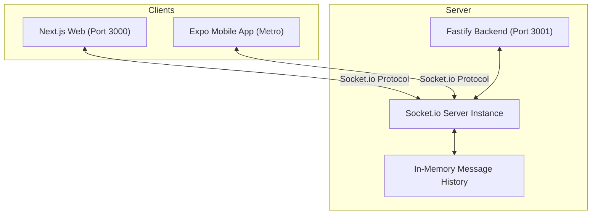

# Tutorial: Building a Real-Time Global Chat (Web & Mobile) using Socket.io in a Monorepo

Welcome! In this guide, you will learn how to build a real-time global chat feature from scratch that works seamlessly on both a Next.js Web application and an Expo (React Native) Mobile app, communicating with a Fastify backend.

We will walk through the structure, the steps taken, code details, and critical problems we solved along the way.

---

## 1. Architecture Overview

Here is a high-level view of how the real-time system is connected:



- **Backend (Fastify + Socket.io)**: Listens for incoming connections, serves historical messages on connection, manages message event routing, and keeps a sliding history of the last 100 messages in memory.
- **Web App (Next.js 16 + Tailwind CSS v4)**: A browser client that establishes a socket connection, handles clean message styling (current user vs others), provides quick-access emoji buttons, and implements autoscrolling.
- **Mobile App (Expo + React Native)**: A native client that connects to the server using dynamically resolved network IP addresses, rendering a keyboard-aware chat list.

---

## 2. Dependency Management in a Monorepo

This project is structured as a **Turborepo** monorepo using `pnpm`. A single lockfile (`pnpm-lock.yaml`) is maintained at the root.

### Problem Faced
If you navigate inside `apps/web` or `apps/mobile` and run standard commands like `pnpm install socket.io-client`, it generates a local lockfile. This isolates the package and completely breaks shared workspace references (like `@repo/auth` or `@repo/db`).

### Solution
Always run package additions from the **workspace root** using the `--filter` flag to scope them correctly:

```bash
# Add socket.io-client to the Next.js Web project
pnpm --filter web add socket.io-client

# Add socket.io-client to the Expo Mobile project
pnpm --filter mobile add socket.io-client
```

---

## 3. Backend Implementation (Fastify + Socket.io)

The backend server is located at `apps/api/src/index.ts`. Fastify handles HTTP requests and shares its underlying Node server with Socket.io.

### The Code (`apps/api/src/index.ts`)
We updated the connection handler to manage global chat messages:

```typescript
interface ChatMessage {
  id: string;
  username: string;
  text: string;
  timestamp: string;
}

// In-memory sliding buffer for historical messages
const chatHistory: ChatMessage[] = [];
const MAX_HISTORY = 100;

io.on("connection", (socket: Socket) => {
  // 1. Send historical messages immediately upon connection
  socket.emit("chat:history", chatHistory);

  // 2. Listen for incoming message requests
  socket.on("chat:send-message", (data: { username: string; text: string }) => {
    if (!data || typeof data.text !== "string" || !data.username) {
      return;
    }

    const message: ChatMessage = {
      id: Math.random().toString(36).substring(2, 11),
      username: data.username,
      text: data.text,
      timestamp: new Date().toISOString(),
    };

    // Keep history bounded
    chatHistory.push(message);
    if (chatHistory.length > MAX_HISTORY) {
      chatHistory.shift();
    }

    // 3. Broadcast message globally to all connected sockets (including sender)
    io.emit("chat:message", message);
  });
});
```

---

## 4. Web Application Client (`apps/web/app/home/page.tsx`)

On the frontend, we connect to the server when the user session is available.

### Core Concepts

#### Socket Connection Lifecycle Hook
To prevent memory leaks and duplicated connections (a common bug in React dev mode where components mount twice), we initialize the socket inside `useEffect` and return a cleanup/disconnect callback.

```typescript
useEffect(() => {
  if (!session) return;

  const socket = io(SOCKET_URL, {
    withCredentials: true,
    transports: ["websocket", "polling"],
  });
  socketRef.current = socket;

  socket.on("chat:history", (history: ChatMessage[]) => setMessages(history));
  socket.on("chat:message", (message: ChatMessage) => setMessages((prev) => [...prev, message]));

  return () => {
    socket.disconnect(); // Disconnect cleanly on unmount!
  };
}, [session]);
```

#### UX Enhancements
1. **Differentiated Styling**: We check `message.username === session.user.name`. Current user bubbles align right with a violet gradient background; other users' bubbles align left with a light gray background.
2. **Auto-Scrolling**: Using a `messagesEndRef` div, we run `scrollIntoView({ behavior: 'smooth' })` inside a `useEffect` whenever the message array updates.
3. **Emoji Support & Shortcut Bar**: Since emojis are standard Unicode characters, they work out of the box in JSON sockets. To make it easier for web users, we placed a bar of popular clickable emojis that appends characters directly to the input field.

---

## 5. Mobile Application Client (`apps/mobile/app/home.tsx`)

Writing Socket.io for React Native introduces mobile-specific requirements.

### Core Concepts

#### Dynamic Host IP Resolution
In development, `localhost` (127.0.0.1) points to the physical phone or simulator itself, meaning it won't connect to the backend running on your computer. 
- iOS Simulators can access your machine via `localhost`.
- Android Emulators access the host machine via `10.0.2.2`.
- Physical devices require the local LAN IP (e.g., `192.168.1.100`).

The helper `getApiUrl()` resolves this automatically. When initializing the mobile socket:
```typescript
const socketUrl = getApiUrl();
const socket = io(socketUrl, {
  transports: ["websocket"], // React Native works best forcing websockets
  forceNew: true,
});
```

#### Safe Native Inputs & Keyboard Shifting
On mobile screens, standard inputs get covered by the on-screen keyboard. We use React Native's `KeyboardAvoidingView` with a conditional `behavior` (only using `padding` on iOS) and `FlatList` layout bounds to dynamically push the input box above the keyboard.

```typescript
<KeyboardAvoidingView
  style={styles.container}
  behavior={Platform.OS === "ios" ? "padding" : undefined}
  keyboardVerticalOffset={Platform.OS === "ios" ? 90 : 0}
>
  {/* FlatList and input components inside */}
</KeyboardAvoidingView>
```

---

## 6. Crucial Pitfalls & Troubleshooting

### 1. Duplicated Socket Subscriptions
* **Symptom**: Messages appear twice or three times for a single sender.
* **Why**: The React component re-rendered and ran `io()` again, spawning another socket client.
* **Fix**: Save the socket instance to a React `useRef` or local state, and always return a cleanup function in `useEffect` that calls `socket.disconnect()`.

### 2. CORS Blockages
* **Symptom**: Web client console shows `CORS Policy: Access-Control-Allow-Origin missing`.
* **Fix**: In `apps/api/src/index.ts`, ensure that both HTTP CORS and Socket.io CORS match your `allowedOrigins` configuration.

### 3. Transport Handshake Failures on Mobile
* **Symptom**: Mobile socket stuck in infinite reconnecting loop.
* **Why**: The default Socket.io connection starts with HTTP Polling and upgrades to WebSockets. Some React Native environments block/misinterpret this initial polling sequence.
* **Fix**: Explicitly define `transports: ["websocket"]` in the mobile client configuration.

---

With these implementations, users can log into their account on either Web or Mobile and immediately chat with other online users in real-time, complete with full emoji and special character support!
