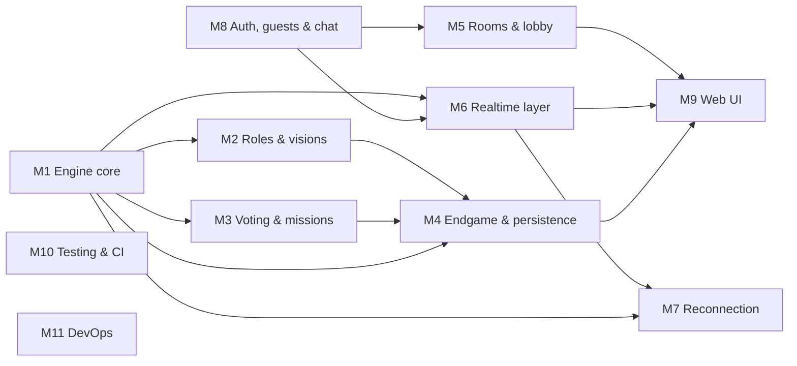

# Module breakdown — v1 remaining work

Derived from `docs/audit.md`. Work that is already done is left out. Partly done items count only their missing part. Every remaining v1 item maps to exactly one module (the table at the end).

**Shared contract, agreed first.** `packages/game-engine` exports `GameState`, `Action`, `GameEvent`, `PlayerView`, `GameConfig` and `reduce()`. Every other module builds against these types; they can stub `reduce` until M1 lands.

---

## M1 — Game engine core
- **Goal:** a pure, tested `reduce(state, action, now, rng)` that implements the §4.4 FSM, timers as data, and role assignment.
- **Scope:** items 12 and 13 · US_5, US_8, US_12, US_17 · §4.1, §4.3, §4.4, §4.5 (as data), §4.2 dependencies.
- **Current state:** `apps/api/src/game/engine.ts` (I/O-bound handlers), `roles.ts` (wrong table, duplicates at 14–15), `roundConfig.ts` (wrong sizes for 11–15). The logic will be ported, not reused.
- **Tasks:**
  - [ ] Create the `packages/game-engine` package (strict TS, Vitest, no I/O deps)
  - [ ] `gameConfig.ts`: the §4.3 table, timers, thresholds, **[DEFAULT]** flags in one place
  - [ ] Types: `Phase`, `GameState`, `Action`, `GameEvent`, `Seat`, `RoleId`, `Team`
  - [ ] Seeded RNG utility
  - [ ] `assignRoles(players, config, toggles, rng)`: unique roles, dependencies, Siraj always present, fillers
  - [ ] FSM: LOBBY → ROLE_REVEAL → DISCUSSION → SELECTION → BALLOT → RESOLUTION → ROUND_RESULT → ENDGAME → POST_GAME
  - [ ] Leader rotation on every nomination; `endsAt` per phase; a `TICK` action applies the timeout defaults
  - [ ] Unit tests for every transition and timeout
- **Owns:** `packages/game-engine/**` (except `vision/`, `ballot/`, `endgame/`, owned by M2–M4). **Reads:** —
- **Interfaces exposed:** `reduce`, `createGame(config, players, seed)`, `GameState`, `Action`, `GameEvent`, `gameConfig`.
- **Depends on:** — · **Blocks:** M2, M3, M4, M6, M7
- **Acceptance:** every phase reachable; timeouts apply §4.5 defaults; `assignRoles` property test (6–15 players × 1000 seeds: no duplicates, dependencies hold, counts match §4.3); `pnpm --filter game-engine test` green.
- **Size:** L · **Owner:** wasi

## M2 — Roles & visions
- **Goal:** `viewFor(state, playerId)` returns exactly what that player may know, plus the de Bussy and Jean Law abilities.
- **Scope:** items 14 and 16 · US_6, US_7, US_10, US_20, US_21 (Appendix B versions) · §4.2, §5 (projection).
- **Current state:** `buildPrivateRoleInfo` in `apps/api/src/game/roles.ts` (Siraj, Lutfunnesa, Tara Bai, Mohon Lal, Ramnarain); Mir Madan in `engine.ts`; `handleDebussyLockOn` / `handleJeanLawLock`. It has three leaks (audit §4).
- **Tasks:**
  - [ ] `viewFor`: own role, the vision list (shuffled, unlabelled where needed), badges, pending actions
  - [ ] Red mutual recognition with the Umichad and Rai Durlabh exceptions
  - [ ] Mir Madan vision limited to Round 1 DISCUSSION
  - [ ] Abilities as actions: `DEBUSSY_REVEAL` (Rai Durlabh shows as Loyalist; target is notified), `JEANLAW_LOCK` (silent; flips only a Green target)
  - [ ] Leak test: for every seat, `viewFor` reveals no other role beyond what §4.2 allows
  - [ ] The item 16 edge-case matrix as tests
- **Owns:** `packages/game-engine/src/vision/**`, `abilities/**`. **Reads:** M1 types.
- **Interfaces exposed:** `viewFor(state, playerId): PlayerView`, `publicView(state): PublicView`.
- **Depends on:** M1 · **Blocks:** M4, M6, M9
- **Acceptance:** leak tests and the full edge matrix green; snapshot tests per role.
- **Size:** M · **Owner:** wasi

## M3 — Voting & missions
- **Goal:** a correct weighted ballot, card play and fail track.
- **Scope:** item 11 · US_9, US_11, US_19 · §1 (double vote), §4.4 ballot / resolution / fail track.
- **Current state:** weights and the tie rule in `handleApprovalVote`; `handleMissionVote` (wrongly weights cards).
- **Tasks:**
  - [ ] Ballot: weight 2 only for Saint Frais / Yar Lutuf; ties reject; missing votes count as Approve on timeout
  - [ ] Results card event: per-player vote + raw headcount (not weighted)
  - [ ] Cards: Greens can only play Success; missing cards count as Success; shuffled counts; the §4.3 threshold
  - [ ] Fail track: +1 per rejection; 5 → round to Red; reset on approval and at round end
  - [ ] Tests for each rule
- **Owns:** `packages/game-engine/src/ballot/**`, `mission/**`. **Reads:** M1.
- **Interfaces exposed:** the `BALLOT_RESULT` and `MISSION_RESULT` events; the `CAST_VOTE` and `PLAY_CARD` actions.
- **Depends on:** M1 · **Blocks:** M4
- **Acceptance:** tests cover the weighted tie, a full rejection track, the R4 two-sabotage case and a Green trying to sabotage (rejected).
- **Size:** S · **Owner:** wasi

## M4 — Endgame, scoring & persistence
- **Goal:** the §4.6 win resolution, and a single transaction saving the result to Postgres.
- **Scope:** item 15 · US_22, US_24, US_25 (data) · §4.6, §6.
- **Current state:** `handleInitialGameEnd`, `handleEndgameGuess`, `endGame` in `engine.ts`. Jean Law credit only half done; no Match tables.
- **Tasks:**
  - [ ] Endgame sequence: Mir Jafar guess → Jagat Seth guess (target set by W) → final credit, each with a 60 s timeout
  - [ ] Win credit, including Jean Law's flipped target and the humiliation flag
  - [ ] Prisma: `Match`, `MatchPlayer`, `Round`, `BallotVote`, and the `User` additions (`username`, `avatarId`, `xp`, `level`)
  - [ ] `saveMatch(state)`: one transaction, guests stored with `guestId`
  - [ ] Post-game report payload (true roles, round timeline)
- **Owns:** `packages/game-engine/src/endgame/**`, the new Prisma models, `apps/api/src/persistence/**`. **Reads:** M1, M2, M3.
- **Interfaces exposed:** the `MATCH_ENDED` event; `saveMatch()`.
- **Depends on:** M1, M2, M3 · **Blocks:** M9 (post-game screen)
- **Acceptance:** tests for every §4.6 branch; an integration test writes one match and reads it back.
- **Size:** M · **Owner:** unassigned

## M5 — Rooms & lobby
- **Goal:** create, customise, join and manage rooms securely.
- **Scope:** items 8 (remaining part) and 9 · US_1, US_2, US_3, US_13, US_26.
- **Current state:** `apps/api/src/routes/rooms.ts` (create/join/leave/get/start; spoofable `userId`; hex-only codes; id-prefix lookup).
- **Tasks:**
  - [ ] Session-based identity on all room routes (uses the M8 `requireSession`)
  - [ ] Code alphabet: A–Z0–9, 6 characters; remove the id-prefix lookup
  - [ ] Settings: max players 6–15, discussion 30–300 s, advanced-role toggles; synced live
  - [ ] Public room list + Quick Join, pushed over the socket
  - [ ] Host kick (+ lobby ban), host migration to the longest-connected player, invite link, live player count
  - [ ] Remove the duplicate REST start path (start lives in M6)
- **Owns:** `apps/api/src/routes/rooms.ts`, `apps/api/src/lobby/**`. **Reads:** M8.
- **Interfaces exposed:** the REST `/rooms*` endpoints; the `lobby:list`, `room:settings`, `room:kicked` events.
- **Depends on:** M8 · **Blocks:** M9
- **Acceptance:** zod-validated routes; tests for kick/ban, migration and the full-room case.
- **Size:** M · **Owner:** wasi

## M6 — Realtime layer
- **Goal:** authenticated, validated, rate-limited socket handlers that drive the engine and emit only `viewFor` output.
- **Scope:** items 17 and 19 · US_30 · §5 (handlers, rejection rule, state storage, timers, rate limiting, cleanup).
- **Current state:** `apps/api/src/socket/index.ts` (unauthenticated; errors broadcast; `console.error`), `lib/redis.ts` (`REDIS_HOST`).
- **Tasks:**
  - [ ] `io.use` middleware: BetterAuth session from the cookie/bearer → `socket.data.userId`; join `user:<id>`
  - [ ] Zod schemas per event; `game:error {code}` to the sender only
  - [ ] Room runtime: in-memory state + Redis snapshot `game:<code>` (TTL 2 h) after every transition; a per-room scheduler from `endsAt`; rebuild after restart
  - [ ] Emit `viewFor` to `user:<id>` and the public view to `room:<code>`
  - [ ] `ioredis` from `REDIS_URL` (TLS for `rediss://`)
  - [ ] `@fastify/rate-limit` + a per-socket token bucket (chat 5/5 s, actions 10/s)
  - [ ] Cleanup: empty lobby after 10 min, finished match after 30 min, socket rooms on disconnect
  - [ ] `docs/events.md`
- **Owns:** `apps/api/src/socket/**`, `apps/api/src/runtime/**`, `apps/api/src/lib/redis.ts`, `docs/events.md`. **Reads:** M1, M2, M8.
- **Interfaces exposed:** every `game:*` socket event (see `docs/events.md`).
- **Depends on:** M1, M8 (M2 for real views; stubs are fine before then) · **Blocks:** M7, M9
- **Acceptance:** integration tests: an unauthenticated socket is rejected; a spoofed `userId` is ignored; an out-of-phase action → `game:error`; the rate limit trips; the snapshot round-trips.
- **Size:** L · **Owner:** unassigned

## M7 — Reconnection & timeouts
- **Goal:** players survive disconnects; the match continues on defaults after the grace period.
- **Scope:** item 18 · US_29 · §1 (disconnect defaults), §4.5 reconnect grace.
- **Current state:** `player:status` online/offline only.
- **Tasks:**
  - [ ] Track presence per seat; start the 60 s grace timer on disconnect; show the "offline" badge
  - [ ] On reconnect: rejoin rooms and re-send `viewFor`
  - [ ] After the grace period: mark the seat as defaulted (Approve, Success, Leader skipped, guess forfeited); `disconnectedForfeit` → a loss
  - [ ] Tests: disconnected Leader, disconnected minister, disconnect during a guess
- **Owns:** `apps/api/src/runtime/presence.ts`, the engine `DISCONNECT` / `RECONNECT` actions. **Reads:** M1, M6.
- **Depends on:** M1, M6 · **Blocks:** —
- **Acceptance:** the integration tests above pass.
- **Size:** M · **Owner:** unassigned

## M8 — Auth, guests & chat
- **Goal:** close the auth gaps and make chat authenticated, filtered and phase-aware.
- **Scope:** items 5, 6, 7 and 10 (remaining parts) · US_4, US_14, US_15, US_18.
- **Current state:** `packages/auth`, `apps/api/src/auth-routes.ts`, the web/admin/mobile auth clients; chat in `socket/index.ts`.
- **Tasks:**
  - [ ] Google OAuth provider (`GOOGLE_CLIENT_ID/SECRET`)
  - [ ] `username` field + validation (3–15 alphanumeric, unique); password rules (≥ 8, a number, a special character)
  - [ ] `requireSession` Fastify hook + a session helper for sockets (consumed by M5 and M6)
  - [ ] Secure `/users/update-profile`; lock `/rooms/dev/create-user` behind an explicit dev flag
  - [ ] Verify the guest ID is stable per browser session
  - [ ] Chat: sender taken from the session; profanity filter (server + client); open in DISCUSSION / POST_GAME, read-only otherwise; per-room history in Redis; fix the `chat:history` / `room:chat-history` mismatch
- **Owns:** `packages/auth/**`, `apps/api/src/auth-routes.ts`, `apps/api/src/chat/**`, the web/mobile auth pages. **Reads:** the M6 phase info.
- **Interfaces exposed:** `requireSession`, `getSocketSession(handshake)`, the `chat:*` events.
- **Depends on:** — · **Blocks:** M5, M6
- **Acceptance:** signup rejects invalid usernames and passwords; a chat message with a forged `userId` is attributed to the session user; the filter masks the word list.
- **Size:** M · **Owner:** satil

## M9 — Minimum playable web UI
- **Goal:** play a full 6-player match in browser tabs.
- **Scope:** item 4 (tokens) + the minimum playable UI row · US_8, US_12, US_17, US_22, US_24, US_25 (display).
- **Current state:** `apps/web/app/room/[id]/page.tsx` (one large client component; `any`; listens for events that are never sent), `home/page.tsx`, DaisyUI themes.
- **Tasks:**
  - [ ] Faction colour tokens (green / red / gold) in the Tailwind theme
  - [ ] Typed socket client using `@repo/types`; render only the server view
  - [ ] Lobby (settings, player count, invite), phase banner + `endsAt` timer (5 s tick), player grid with badges, fail track, scoreboard
  - [ ] Ballot, card play, ability targets, endgame guess, post-game report (the guess and ability handlers exist but no buttons are wired up to them)
  - [ ] Make `pnpm --filter web lint` pass (20 errors today)
  - [ ] Show a "waking server…" state for the Render cold start
- **Owns:** `apps/web/**` except the auth pages. **Reads:** M2, M5, M6 (events).
- **Depends on:** M5, M6 (stub-able), M4 for the post-game screen · **Blocks:** —
- **Acceptance:** a manual 6-tab playtest reaches POST_GAME; no `any`; loading/error/empty states everywhere.
- **Size:** L · **Owner:** unassigned

## M10 — Testing & CI
- **Goal:** test infrastructure and CI that guard every PR into `dev`.
- **Scope:** items 2 (remaining part) and 3 · US_30 (test harness).
- **Current state:** `.github/workflows/ci.yml` (main only, typecheck + build); no tests.
- **Tasks:**
  - [ ] Vitest workspace config; `test` task in `turbo.json`; a root `pnpm test`
  - [ ] Socket integration harness (test server + `socket.io-client`, Redis service)
  - [ ] CI: triggers on PRs to `dev` and pushes to `dev`/`main`; steps `lint`, `typecheck`, `test`, `build`
  - [ ] Fix lint: add `eslint.config.mjs` to `apps/admin`; add `lint` scripts to `apps/api`, `packages/auth` and `packages/db`
  - [ ] Untrack build artefacts (`*.tsbuildinfo`, `dev.log`, `packages/types/src/index.{js,d.ts,d.ts.map}`) and add them to `.gitignore`
- **Owns:** `.github/**`, `vitest.workspace.ts`, `turbo.json` (the test task), `test/helpers/**`. **Reads:** —
- **Depends on:** — · **Blocks:** — (every module uses it)
- **Acceptance:** a PR to `dev` runs all four steps; a failing test fails CI.
- **Size:** S · **Owner:** unassigned

## M11 — DevOps
- **Goal:** one-command local stack and a clean deploy.
- **Scope:** item 20.
- **Current state:** `docker-compose.yml` (Redis only); the `origin/feat/dockerize` branch (not yet reviewed).
- **Tasks:**
  - [ ] Review and merge `feat/dockerize` (once approved)
  - [ ] API Dockerfile; compose with api + redis + optional postgres
  - [ ] Add `REDIS_URL` to `turbo.json` `globalEnv`; Render env checklist (`NODE_ENV=production`)
  - [ ] Rewrite the README: setup, env, scripts, the Render cold-start note
- **Owns:** `docker-compose.yml`, `Dockerfile*`, `README.md`, `.env.example`. **Reads:** —
- **Depends on:** — · **Blocks:** —
- **Acceptance:** `docker compose up` gives a working API with `/health` OK; the README steps work on a clean clone.
- **Size:** S · **Owner:** safwan

---

## Dependency graph

## Waves

| Wave | Modules | Notes |
|---|---|---|
| 1 | **M1**, **M8**, **M10**, **M11** | No dependencies. Agree the M1 types first, on day 1 |
| 2 | **M2**, **M3**, **M5**, **M6** | M6 can start in wave 1 against stubbed `reduce` |
| 3 | **M4**, **M7**, **M9** | M9 can scaffold earlier against stub events |

## Item → module map

| Doc # | Item | Module |
|---|---|---|
| 1 | Setup | done |
| 2 | CI/CD | M10 |
| 3 | Automated testing | M10 (infra; each module writes its own tests) |
| 4 | Colour palette | M9 |
| 5 | Login/signup/guest | M8 |
| 6 | Unique guest IDs | M8 |
| 7 | Logged-in chat | M8 |
| 8 | Join room by ID | M5 |
| 9 | Customisable room | M5 |
| 10 | Real-time chat | M8 |
| 11 | Voting mechanism | M3 |
| 12 | Rounds mechanism | M1 |
| 13 | Role assignment | M1 |
| 14 | Role powers | M2 |
| 15 | Team points / endgame | M4 |
| 16 | Edge role cases | M2 |
| 17 | Room cleanups | M6 |
| 18 | Timeouts & reconnection | M7 |
| 19 | Rate limiting | M6 |
| 20 | Dockerize | M11 |
| — | Minimum playable UI | M9 |

---

## Post-mid modules (coarse; not v1)

| ID | Name | Scope (§8) | Depends on |
|---|---|---|---|
| P1 | Profiles & progression | 21 player profile (US_16, US_28), XP/level, Redis stats cache | M4, M8 |
| P2 | Achievements | 23, including the Jean Law humiliation trophy | M4, P1 |
| P3 | Social & comms | 24 socials, 25 feedback/contact, 26 email/report, 27 push notifications | M8 |
| P4 | Full UI set | 22 offline UI, 28–38 screens, 39 theme/music/SFX (US_27) | M9 |
| P5 | Admin dashboard | 40 (`apps/admin`) | M4, M8 |
| P6 | Scale & observability | 41 load/E2E tests, 42 Socket.IO Redis adapter, 43 Sentry | M6, M10 |
| P7 | Voice & private chat | 44 voice chat, private spy chat | M6, M8 |
| P8 | Mobile app | Expo client parity | M9 |
